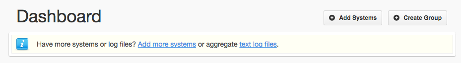
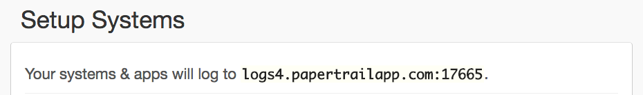

Just a quick post on how to ship logs from dokku applications to Papertrail.

*Note: This should work with other providers such as Logentries Loggly or Splunk*

## Install the dokku-logspout plugin

In order to ship logs from dokku we need to install the [`dokku-logspout`](https://github.com/michaelshobbs/dokku-logspout) plugin.

First, either ssh into the server where dokku is installed or use the [`dokku-cli`](https://github.com/SebastianSzturo/dokku-cli) gem and then run:

```bash
dokku plugin:install https://github.com/michaelshobbs/dokku-logspout.git
```

At this point we can check that logs are streaming by running...

```bash
dokku logspout:stream
```


## Create your Papertrail system

Log into your Papertrail account and click on the "Add Systems" button



After this we want to copy the URL that Papertrail gives us. This is where we ship our logs.



In my case the URL is logs4.papertrailapp.com:17665

## Configure Logspout

To ship logs to our newly created system we need to give Logspout the URL from above.

To do this we edit the `/home/dokku/.logspout/OPTS` to add the `DOKKU_LOGSPOUT_SYSLOG_SERVER` variable with our copied URL - be sure to include the prefix `syslog+tls://`:

```bash
export DOKKU_LOGSPOUT_PORT=18000
export DOKKU_LOGSPOUT_IMAGE_VERSION=v3.1
export DOKKU_LOGSPOUT_SYSLOG_SERVER=syslog+tls://logs4.papertrailapp.com:17665
```

Finally we restart the logspout container and if you have any issues with your applications then it can be a good idea to rebuild those too.

```bash
dokku logspout:stop
dokku logspout:start

# And if your logs aren't shipping try...

dokku ps:rebuildall
```

## Conclusion


As you can see in the image above, Logspout -> Papertrail allows us to see logs from all our dokku containers in one place. We can also filter by application.

Special thanks to [Michael Hobbs](https://github.com/michaelshobbs) for creating the plugin and helping me troubleshoot some issues.
