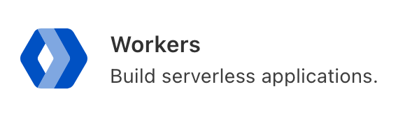
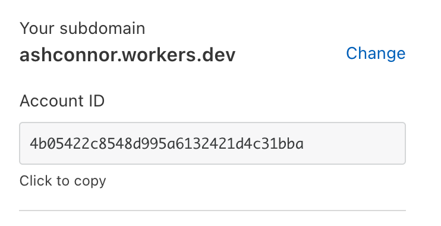

## Introduction

Recently I've been using SvelteKit as the frontend for a project I've been working on and after some local development I wanted to get it up and
running on the cloud.

I chose [Cloudflare Workers](https://workers.cloudflare.com/) as I already have an account with them (this blog is hosted on [Cloudflare Pages](https://pages.cloudflare.com/)) however, the documentation on using the [adapter-cloudflare-workers](https://github.com/sveltejs/kit/tree/master/packages/adapter-cloudflare-workers) is pretty sparse so I'll cover how I got it deployed here.

## SvelteKit adapter configuration

If you don't have an existing SvelteKit project you can follow allowing by generating the demo project:

```shell
$ npm init svelte@next my-cloudflare-workers-demo
? Which Svelte app template? › - Use arrow-keys. Return to submit.
❯   SvelteKit demo app # select this
    Skeleton project
✔ Use TypeScript? … No / Yes
✔ Add ESLint for code linting? … No / Yes
✔ Add Prettier for code formatting? … No / Yes
✔ Copied project files

$ cd my-cloudflare-workers-demo
$ npm install
```

Once you're at the root of your project we can install the adapter:

```shell
$ npm i @sveltejs/adapter-cloudflare-workers@next
```

Next, let's configure the adapter in our `svelte.config.js`:

```javascript
// first import the adapter
import adapter from '@sveltejs/adapter-cloudflare-workers';

// then in the config object, add an adapter key under kit, and call the imported library
const config = {
	kit: {
		// hydrate the <div id="svelte"> element in src/app.html
		target: '#svelte',
		adapter: adapter()
	}
};
...
```

That's all that's required from SvelteKit. Now onto the Cloudflare Workers configuration.

## Wrangler

### Configuration

To deploy to Cloudflare we will install the [Wrangler CLI](https://developers.cloudflare.com/workers/cli-wrangler/install-update) tool and generating an empty configuration:

```shell
$ npm i @cloudflare/wrangler -g
$ wrangler init --site my-cloudflare-workers-demo
🕵️  You can find your zone_id in the right sidebar of a zone's overview tab at https://dash.cloudflare.com
🕵️  You can find your account_id in the right sidebar of your account's Workers page
🕵️  You will need to update the following fields in the created wrangler.toml file before continuing:
- account_id
✨  Successfully scaffolded workers site
✨  Successfully created a `wrangler.toml`
```

Now let's follow the instructions given and login to our [Cloudflare](https://dash.cloudflare.com) dashboard to find our `account_id`.

Login and then click on the "Workers" menu item on the right-hand side of the page:



Copy your Account ID from the sidebar:



Optionally if you have a domain setup with Cloudflare that you wish to use with your Cloudflare Workers, grab the `zone_id` from your domain's dashboard.

Now edit your `wrangler.toml` configuration file with those values:

```toml
account_id = '4b05422c8548d995a6132421d4c31bba'
zone_id    = '2ea755fa5c01136f1d07a2013c2d1c6f' # optional, if you don't specify this a workers.dev subdomain will be used.
```

Finally, we also need to make some adjustments to the `site` key pointing it to the directories that will be generated by running build stage later on.

```toml
site = {bucket = "./build", entry-point = "./workers-site"}
```

### Authorization

Next, let's authorize our Wrangler client so we can deploy our project:

```shell
$ wrangler login
Allow Wrangler to open a page in your browser? [y/n]
y
💁  Opened a link in your default browser: https://dash.cloudflare.com/wrangler?key=...
💁  Validating credentials...
✨  Successfully configured. You can find your configuration file at: /Users/ashleyconnor/.wrangler/config/default.toml
```

## Build our project and deploy

First, we need to build our project which we can do using `npm run build`:

```shell
$ npm run build

> my-cloudflare-workers-demo@0.0.1 build
> svelte-kit build

vite v2.3.7 building for production...
✓ 34 modules transformed.
...
✓ 27 modules transformed.
.svelte-kit/output/server/app.js   64.33kb
...
> Using @sveltejs/adapter-cloudflare-workers
  ✔ done
```

Then run the `wrangler publish` command:

```shell
$ wrangler publish
up to date in 0.729s
found 0 vulnerabilities

✨  Built successfully, built project size is 33 KiB.
🌀  Created namespace for Workers Site "__my-cloudflare-workers-demo-workers_sites_assets"
✨  Success
🌀  Uploading site files
✨  Successfully published your script to
 https://my-cloudflare-workers-demo.ashconnor.workers.dev
```

Your Server Side Rendered SvelteKit application should be up and running on the URL above.

You can visit the demo SvelteKit application running on Cloudflare Workers [here](https://my-cloudflare-workers-demo.ashconnor.workers.dev).
