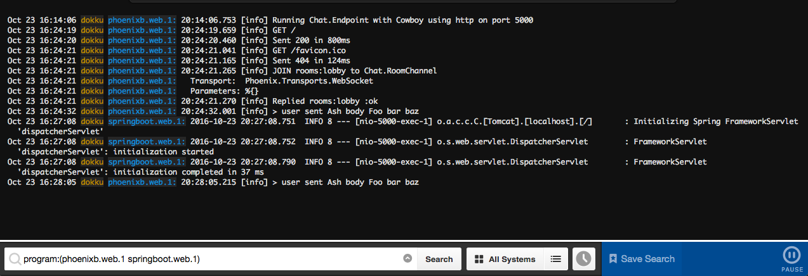

import Figure from '@ac/ui/components/Figure.astro';
import Callout from '@ac/ui/components/Callout.astro';
import Gallery from '@ac/ui/components/Gallery.astro';
import logs from '../_images/papertrail/logs.png';
import dashboard from '../_images/papertrail/dashboard.png';
import before from '../_images/automator/before.png';
import after from '../_images/automator/after.png';
import contextMenu from '../_images/automator/context_menu.png';
import quickAction from '../_images/automator/quick_action.png';
import workflow from '../_images/automator/workflow.png';
import chrome from '../_images/WSL2/chrome_ssl_success.png';

This page is a reference, not a post. It is a draft, so it only appears on PR previews and in local development with drafts shown. Each section shows one thing the design can render, in Markdown or as a component, so you can see how it looks in context. The opening paragraph like this one sits directly under the title and meta line.

## Text

Body text is Inter on the navy background. Inline styles: **bold**, *italic*, ***bold italic***, ~~strikethrough~~, and a [link to another post](/2022/04/03/pay-transparency/) or [an external site](https://example.com/). Inline code looks like `asyncio.run(main())`, and a keyboard shortcut like <kbd>⌘</kbd> + <kbd>K</kbd>.

A second paragraph shows the spacing between paragraphs. Short paragraphs sit 1em apart, so a run of one-line thoughts reads together.

Like this.

And this.

### A third-level heading

Third-level headings appear in the table of contents but get no divider.

#### A fourth-level heading

Fourth-level headings are the smallest, and stay out of the table of contents.

## Quotes

> A blockquote for quoting someone else. It can run over several lines and keeps the reading column's width, with a hairline on the left.
>
> It can also hold more than one paragraph, and **inline formatting**.

## Lists

An unordered list:

- First item
- Second item, with `inline code`
  - A nested item
  - Another nested item
- Third item

An ordered list:

1. Install the dependencies
2. Run the build
3. Deploy

A task list:

- [x] Migrate the posts
- [x] Cut over the domains
- [ ] Write the next post

## Table

| Site | Host | Served by |
| --- | --- | --- |
| Blog | www.ashleyconnor.co.uk | Cloudflare Worker `blog` |
| TIL | til.ashleyconnor.co.uk | Cloudflare Worker `til` |
| Apex | ashleyconnor.co.uk | Redirect rule to www |

## Code

A code block with a language and a file name:

```python title="run_sync.py"
import asyncio


def run_sync(coro):
    """Run a coroutine from synchronous code, inside or outside a running loop."""
    try:
        asyncio.get_running_loop()
    except RuntimeError:
        return asyncio.run(coro)
    raise RuntimeError("Already inside an event loop: await the coroutine instead")
```

Shell commands get a terminal frame:

```bash
pnpm new --type til --title "Zsh glob qualifiers" --tags tools
pnpm review:check content/til/2026-10-28-zsh-glob-qualifiers.md
```

Highlighted lines, and inserted and deleted lines:

```ts title="astro.config.ts" {3} ins={6} del={5}
export default defineConfig({
  output: 'static',
  site: 'https://www.ashleyconnor.co.uk',
  trailingSlash: 'always',
  build: { format: 'directory' },
  build: { format: 'directory', inlineStylesheets: 'always' },
});
```

A diff:

```diff
- <link rel="stylesheet" href="/_astro/site.css">
+ <style>/* inlined */</style>
```

A long line scrolls sideways instead of wrapping:

```text
Error: It looks like you are using Playwright Sync API inside the asyncio loop. Please use the Async API instead.
```

## Callouts

<Callout type="note">
A note adds context the reader might want, without interrupting the flow.
</Callout>

<Callout type="tip">
A tip suggests a better way to do something. It can hold `inline code` and [links](https://example.com/).
</Callout>

<Callout type="warning">
A warning flags something that could go wrong, like running a command against production.
</Callout>

## Images

A Markdown image fills the reading column:



A figure with a caption:

<Figure src={dashboard} alt="The Papertrail dashboard with an Add Systems button" caption="Figure 1 — A figure with a caption" />

A wide figure spreads past the reading column on larger screens:

<Figure src={logs} alt="Papertrail log lines from two Dokku apps, shown wide" caption="Figure 2 — A wide figure" wide />

## Gallery

A gallery is a grid of thumbnails. Click one to open it full size in the lightbox, then use the arrow keys to move between images.

<Gallery
  images={[
    { src: before, alt: 'A folder of images before the Automator action runs', caption: 'Before' },
    { src: after, alt: 'The same folder after the action runs', caption: 'After' },
    { src: contextMenu, alt: 'The Finder context menu with Quick Actions' },
    { src: quickAction, alt: 'The Quick Action listed in the context menu' },
    { src: workflow, alt: 'The finished Automator workflow' },
    { src: chrome, alt: 'Chrome showing a valid local certificate' },
  ]}
/>

## Footnotes and other bits

A sentence with a footnote.[^1] A horizontal rule separates loosely related material:

---

<details>
<summary>A collapsible section</summary>

Hidden content that opens when the reader clicks the summary.

</details>

## Wrapping up

The last section, so the table of contents has something to end on.

[^1]: Footnotes collect at the bottom of the post, with a link back to where they were cited.
