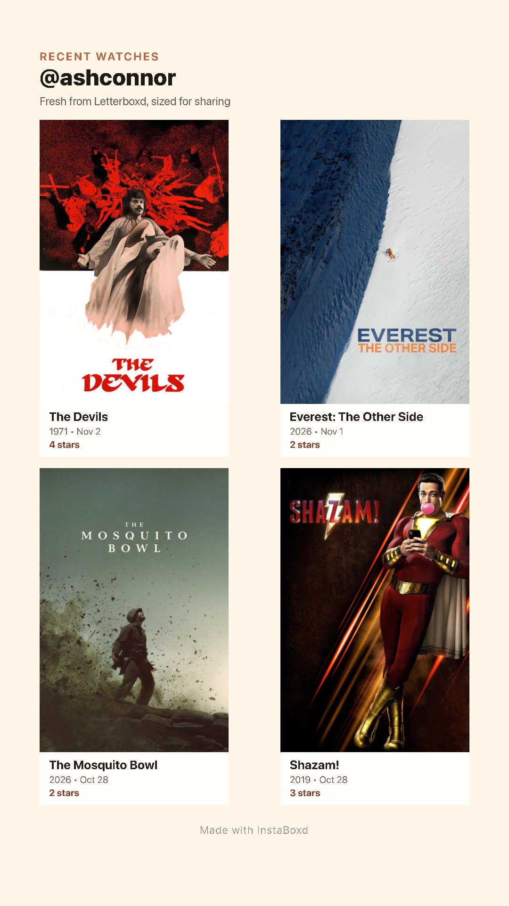

My first application to the Apple App Store was approved today after a bit of back-and-forth during the review process. Apple appears to be overwhelmed with new app submissions due to the proliferation of vibe-coded applications.

Approval was granted after three weeks.

## COMP327

The first time I developed for iOS was back in 2011 for my undergraduate course at the University of Liverpool. COMP327 was a
module on "Mobile Computing" focused on iOS 5 development using Objective-C (Swift didn't exist until 3 years later).

The original lecture notes for the introductory lecture are still available [here](https://cgi.csc.liv.ac.uk/~trp/Teaching_Resources/COMP327/327-Lecture1.pdf).

## Many failed attempts later

Since completing that course I had always retained an interest in becoming a iOS developer. One of the reasons I liked iOS development was the same reason I liked programming backend more than frontend, _I had predictable control over where the code runs_.

This was thanks to Apple bundling hardware and software together and providing a stable development API. The downsides are hardware limitations and
most importantly, being at the mercy of the Apple review process which can sometimes be arbitary and unfair.

Despite this I kept reading [books](https://www.oreilly.com/search/?q=*&publishers=Big%20Nerd%20Ranch%20Guides&rows=50) on mobile development, even tinkering with small Android projects. Still I never shipped an app.

I worried that I would:

1. Ship an app nobody uses.
1. Mess up the process and get myself banned from the App Store.

Then after speaking with a former coworker, who has shipped several apps to both the Google Play and Apple App Store. I decided screw it, I'll
ship the app I had been using myself for several months on my own device.

So after many years of procrastination, I have finally published my first app [InstaBoxd](https://apps.apple.com/us/app/instaboxd/id6762489841) in the App Store.

InstaBoxd is a tiny application that allows you to post your recent [Letterboxd](https://letterboxd.com/) watched list to Instagram (or anywhere else).

